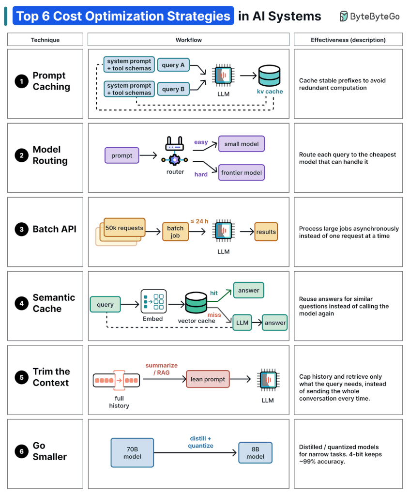
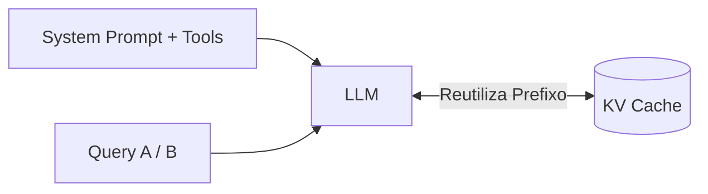
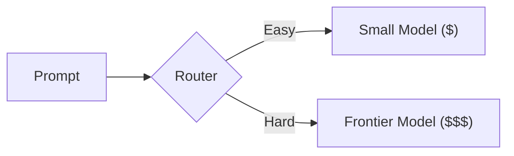
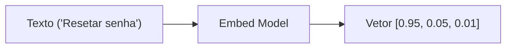
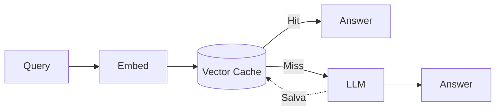
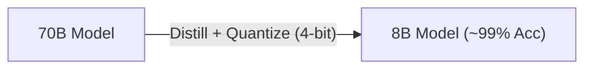
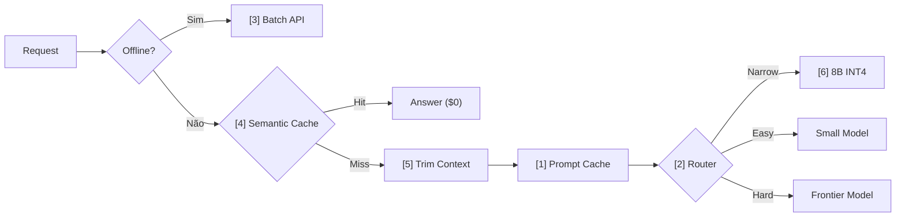

<p align="center">
  
  
  
  
</p>

# 💰 Top 6 Estratégias de Otimização de Custos em Sistemas de IA

> **Guia de Arquitetura, FinOps para LLMs & Estudo Prático em Produção**  
> *Análise aprofundada das 6 principais técnicas para reduzir faturas de IA em até 90% sem sacrificar a qualidade: Prompt Caching (KV Cache), Model Routing, Batch API, Semantic Cache, Trim the Context e Smaller Models (Destilação & Quantização).*

---

## 📌 Sumário

1. [Por Que as Contas de IA Crescem Tão Rápido?](#-1-por-que-as-contas-de-ia-crescem-tão-rápido)
2. [Visão Geral das 6 Estratégias (Diagrama de Referência)](#-2-visão-geral-das-6-estratégias-diagrama-de-referência)
3. [Análise Profunda das 6 Técnicas](#-3-análise-profunda-das-6-técnicas)
   - [1. Prompt Caching (Cache de Prefixo & KV Cache)](#1-prompt-caching-cache-de-prefixo--kv-cache)
   - [2. Model Routing (Roteamento Inteligente de Modelos)](#2-model-routing-roteamento-inteligente-de-modelos)
   - [3. Batch API (Processamento Assíncrono em Lote)](#3-batch-api-processamento-assíncrono-em-lote)
   - [4. Semantic Cache (Cache Semântico Vetorial)](#4-semantic-cache-cache-semântico-vetorial)
   - [5. Trim the Context (Poda e Compressão de Contexto)](#5-trim-the-context-poda-e-compressão-de-contexto)
   - [6. Go Smaller — Modelos Menores (Destilação e Quantização)](#6-go-smaller--modelos-menores-destilação-e-quantização)
4. [Em Produção: Quais Técnicas São Mais Úteis?](#-4-em-produção-quais-técnicas-são-mais-úteis)
   - [Ordem de Adoção Recomendada (Fases de Maturidade)](#ordem-de-adoção-recomendada-fases-de-maturidade)
   - [Arquitetura Unificada: O Pipeline de 6 Camadas em Produção](#arquitetura-unificada-o-pipeline-de-6-camadas-em-produção)
   - [Matriz Comparativa de Trade-offs e ROI](#matriz-comparativa-de-trade-offs-e-roi)
5. [Simulador Prático em Python & Suíte de Testes](#-5-simulador-prático-em-python--suíte-de-testes)

---

## 📈 1. Por Que as Contas de IA Crescem Tão Rápido?

Em provas de conceito (PoCs), uma chamada a um Large Language Model (LLM) custa frações de centavo. Porém, ao escalar para produção com milhares de usuários simultâneos, fluxos de agentes autônomos e múltiplos turnos de conversação, a fatura de inferência frequentemente se torna o maior custo de infraestrutura da empresa.

Existem **três fatores matemáticos e arquiteturais** que explicam essa explosão de custos:

1. **Sobrecarga de Prefixo Fixo Repetitivo**: Aplicações modernas enviam extensos *System Prompts*, instruções de segurança, dezenas de *Tool Schemas* (JSON Schema de funções/MCP) e exemplos *few-shot* em **todas as requisições**. Não é incomum enviar 8.000 tokens de contexto fixo para processar uma pergunta do usuário de apenas 20 tokens.
2. **Crescimento Quadrático em Conversas Multi-Turn ($O(T^2)$)**: Como as APIs de LLMs são *stateless*, a aplicação precisa reenviar o histórico da conversa a cada turno. Em uma conversa de $T$ turnos onde cada turno adiciona $M$ tokens, o total de tokens faturados ao longo da sessão cresce proporcionalmente a:

$$\text{Tokens Totais} = \sum_{i=1}^{T} (P_{\text{system}} + i \cdot M) = T \cdot P_{\text{system}} + M \cdot \frac{T(T+1)}{2}$$

3. **Superdimensionamento de Modelos (*Over-provisioning*)**: Usar um modelo de fronteira (*Frontier Model*) de altíssimo custo para tarefas triviais como classificar sentimento, extrair um CPF de um texto ou responder dúvidas repetitivas de FAQ.

---

## 🖼️ 2. Visão Geral das 6 Estratégias (Diagrama de Referência)

O diagrama abaixo (referência *ByteByteGo*) sintetiza os 6 pilares fundamentais para otimização de custos em sistemas de IA modernos:

<p align="center">
  
</p>

| # | Técnica | Fluxo de Trabalho (Workflow) | Eficácia e Propósito Principal |
|:-:|:---|:---|:---|
| **1** | **Prompt Caching** | `system prompt + tool schemas` + `query A/B` → `LLM` ↔ `kv cache` | Faz cache de prefixos estáveis para evitar computação redundante na GPU. |
| **2** | **Model Routing** | `prompt` → `router` → (`easy` → `small model` \| `hard` → `frontier model`) | Roteia cada query para o modelo mais barato capaz de resolvê-la com qualidade. |
| **3** | **Batch API** | `50k requests` → `batch job` ($\le 24\text{h}$) → `LLM` → `results` | Processa grandes volumes assincronamente em lote com descontos de ~50%. |
| **4** | **Semantic Cache** | `query` → `Embed` → `vector cache` → (`hit` → `answer` \| `miss` → `LLM`) | Reutiliza respostas para perguntas semanticamente similares sem acionar o LLM. |
| **5** | **Trim the Context** | `full history` → `summarize / RAG` → `lean prompt` → `LLM` | Limita o histórico e recupera apenas o que a query precisa em vez de enviar tudo. |
| **6** | **Go Smaller** | `70B model` $\xrightarrow{\text{distill + quantize}}$ `8B model` | Modelos destilados e quantizados para tarefas específicas (4-bit mantém ~99% da acurácia). |

---

## 🔬 3. Análise Profunda das 6 Técnicas

---

### 1. Prompt Caching (Cache de Prefixo & KV Cache)

> *"Esta técnica armazena em cache prefixos estáveis, como system prompts e esquemas de ferramentas (tool schemas). Isso significa que o modelo pode pular computações redundantes em requisições que compartilham o mesmo prefixo."*

#### ⚙️ Como Funciona por Baixo dos Panos (KV Cache)
A inferência de um Transformer ocorre em duas fases distintas:
1. **Fase de Prefill (Processamento do Prompt)**: O modelo processa todos os tokens de entrada em paralelo, calculando os vetores de **Key ($K$)** e **Value ($V$)** em cada camada de atenção (*Self-Attention*) e armazenando-os no **KV Cache** na memória de alta largura de banda (HBM) da GPU. Esta fase é intensiva em computação (*compute-bound*).
2. **Fase de Decode (Geração de Tokens)**: O modelo gera um token por vez de forma autorregressiva, consultando o KV Cache já calculado.

Sem *Prompt Caching*, se você enviar 1.000 requisições contendo o mesmo `system prompt + 30 tool schemas` (ex: 10.000 tokens) seguidos de uma pergunta diferente (`query A`, `query B`), o cluster de GPUs recalculará exatamente os mesmos tensores $K$ e $V$ para os primeiros 10.000 tokens 1.000 vezes!

Com **Prompt Caching**, o provedor (Anthropic, OpenAI, Google Gemini, DeepSeek, vLLM) armazena em cache os tensores $K$ e $V$ correspondentes ao prefixo exato de tokens:



```
Requisição 1 (Query A):
┌───────────────────────────────────────┬──────────────┐
│ System Prompt + Tool Schemas (10k tk) │   Query A    │ ──► Computa tudo e salva prefixo no KV Cache
└───────────────────────────────────────┴──────────────┘

Requisição 2 (Query B):
┌───────────────────────────────────────┬──────────────┐
│ System Prompt + Tool Schemas (10k tk) │   Query B    │ ──► ⚡ KV CACHE HIT! Pula os 10k tokens!
└───────────────────────────────────────┴──────────────┘     Computa apenas os tensores da Query B.
```

#### ⚠️ Regra de Ouro Arquitetural (Evitando *Cache Busting*)
O KV Cache depende da **correspondência exata de prefixo token a token** (pois na atenção causal, cada token atende a todos os tokens anteriores). Qualquer alteração no início do prompt invalida todo o cache subsequente.

```
❌ ANTI-PATTERN (Quebra o Prompt Cache em toda requisição):
[System Prompt: "Hoje é 2026-11-09T22:26:24Z. User ID: 9812..."] + [Tool Schemas] + [Exemplos] + [Query]
  ↑ Muda a cada segundo! O KV Cache NUNCA dará hit!

✅ BEST PRACTICE (Prefixo 100% Estático → Sufixo Dinâmico):
[System Prompt Estático] + [Tool Schemas Ordenados] + [Few-Shot Fixos] + [Contexto Dinâmico / Data / Query]
└────────────────────────── Prefixo Cacheável (Hit: 90% off) ──────────┘   └──── Processado sob demanda ───┘
```

#### 📊 Impacto em Produção
- **Economia Financeira**: Desconto de **50% a 90%** nos tokens de entrada cacheados (ex: OpenAI oferece 50%–75% off automaticamente para prefixos > 1.024 tokens; Anthropic e Gemini oferecem até 75%–90% off).
- **Redução de Latência (TTFT)**: Reduz o *Time To First Token* em até **60% a 80%** em prompts longos.
- **Risco de Qualidade**: **Zero (0%)**. A saída matemática do modelo é bit-a-bit idêntica à computação completa.

---

### 2. Model Routing (Roteamento Inteligente de Modelos)

> *"Um roteador envia consultas simples para um modelo pequeno e requisições difíceis para um modelo de fronteira. Como na prática grande parte das consultas é simples, isso economiza muito dinheiro."*

#### ⚙️ Como Funciona por Baixo dos Panos
Em qualquer sistema real de produção, a complexidade das requisições segue a **Lei de Pareto (80/20)**:
- **~70% a 80% das chamadas são simples (`easy`)**: saudações, extrações de JSON simples, traduções diretas, dúvidas de FAQ, triagem de intenção ou leitura em massa de arquivos.
- **~20% a 30% das chamadas são complexas (`hard`)**: raciocínio matemático multi-etapas, arquitetura de sistemas, depuração de condições de corrida (*race conditions*) ou síntese estratégica.

A diferença de preço entre um **Frontier Model** (ex: \$5.00 a \$15.00 por 1M de tokens) e um **Small/Flash Model** (ex: \$0.10 a \$0.25 por 1M de tokens) chega a ser de **20x a 60x**.



#### 🏗️ 3 Padrões de Implementação de Routers
1. **Classificador de Complexidade Pré-Inferência (*Intent / Complexity Classifier*)**: Um modelo pequeno (como um DeBERTa fine-tunado, Regressão Logística sobre embeddings, ou regras determinísticas de tamanho/domínio) avalia o prompt em `< 10ms` e atribui um score de complexidade $c \in [0, 1]$. Se $c < \theta$, envia ao modelo pequeno; caso contrário, envia ao modelo de fronteira.
2. **Cascata com Fallback de Confiança (*Model Cascading*)**: Envia primeiro ao modelo pequeno. Um verificador leve avalia a resposta (ex: validação de schema Pydantic, logprobs de confiança ou juiz leve). Se a confiança for baixa ou o JSON falhar, reexecuta no modelo de fronteira.
3. **Delegação de Sub-agentes e Hooks Determinísticos**: Em agentes de código, intercepta leituras de arquivos grandes (`> 350 linhas`) e geração de *boilerplate* para workers leves (veja nosso módulo completo em [`agentic-token-optimization`](../agentic-token-optimization)).

#### 📊 Impacto em Produção
- **Economia Financeira**: **50% a 85%** de redução direta na fatura mensal.
- **Impacto na Latência**: Redução drástica na latência média (P50/P90), pois modelos menores geram tokens 3x a 5x mais rápido que modelos de fronteira.

---

### 3. Batch API (Processamento Assíncrono em Lote)

> *"Esta técnica processa grandes tarefas de forma assíncrona, agrupando as requisições primeiro e enviando-as em lote. Os provedores frequentemente oferecem descontos expressivos em requisições em batch."*

#### ⚙️ Como Funciona por Baixo dos Panos
O maior desafio operacional dos provedores de IA (OpenAI, Anthropic, Google Cloud, AWS Bedrock) é a **capacidade ociosa de GPUs fora do horário de pico**. Durante o horário comercial, os clusters operam no limite para atender tráfego síncrono em tempo real; de madrugada, milhares de GPUs ficam subutilizadas.

A **Batch API** permite que você submeta um arquivo (geralmente `.jsonl`) contendo dezenas de milhares de requisições (ex: `50k requests`) sem exigência de resposta imediata, com uma janela de entrega garantida de **até 24 horas ($\le 24\text{h}$)**:


Ao desacoplar a requisição da latência síncrona, o provedor aloca seu job nos momentos de vale de tráfego com tamanho máximo de lote na GPU (*maximum batch size*), repassando essa eficiência na forma de **50% de desconto fixo** em tokens de entrada e saída, além de **limites de taxa (*Rate Limits / TPM*) muito superiores** aos da API síncrona.

#### 🎯 Casos de Uso Ideais vs Onde Não Usar
- **Use Batch API para**:
  - Classificação, categorização e enriquecimento de catálogos de produtos (milhões de SKUs).
  - Sumarização noturna de chamadas de suporte, tickets de atendimento ou transcrições de vendas.
  - Geração em massa de embeddings para indexação de bases de conhecimento (RAG).
  - Execução de suítes de avaliação (*LLM Evals* / *LLM-as-a-Judge*) em pipelines de CI/CD ou datasets de regressão.
  - Geração de dados sintéticos para destilação de modelos (conectando-se à Estratégia #6).
- **NÃO use para**: Chatbots interativos, copilotos em tempo real ou fluxos onde o usuário humano aguarda na tela.

---

### 4. Semantic Cache (Cache Semântico Vetorial)

> *"Utilizamos um modelo de embedding para armazenar consultas em cache. Quando ocorre um acerto (hit), a resposta armazenada é reutilizada em vez de chamar o modelo novamente."*

#### 🧬 O que é um Embedding? (Explicação Breve & Exemplo Prático)

Um **Embedding** é a tradução de um texto (palavra, frase ou parágrafo) em uma **lista de números reais (um vetor matemático)** — por exemplo, `[0.85, 0.91, -0.12, ...]` — que captura o **significado semântico** daquele texto.



Pense em um embedding como uma **coordenada de GPS para ideias**:
- No mundo físico, duas cafeterias na mesma esquina têm coordenadas de latitude e longitude quase idênticas.
- No espaço vetorial de um modelo de embedding (que geralmente tem de 384 a 1.536 dimensões), **duas frases que querem dizer a mesma coisa recebem coordenadas numéricas muito próximas**, mesmo que usem palavras diferentes!

##### 💡 Exemplo Simplificado em 3 Dimensões
Imagine um modelo de embedding simplificado que avalia cada frase em apenas 3 eixos de significado: `[Segurança/Acesso, Financeiro/Pagamentos, Clima/Natureza]`:

| Frase do Usuário | Vetor Gerado (Embedding) | Similaridade com a Frase A ($\cos\theta$) | Decisão do Cache |
|:---|:---:|:---:|:---:|
| **Frase A (Salva no Cache):** *"Como faço para resetar minha senha?"* | `[0.95, 0.05, 0.01]` | `1.00` *(100%)* | — |
| **Frase B (Nova Query):** *"Esqueci meu código de acesso, quero redefinir"* | `[0.93, 0.08, 0.02]` | **`0.99` *(99%)*** | ⚡ **CACHE HIT!** Reutiliza a resposta da Frase A |
| **Frase C (Nova Query):** *"Como emitir a segunda via do boleto?"* | `[0.10, 0.96, 0.01]` | `0.19` *(19%)* | ❌ **CACHE MISS** (Assunto diferente → chama LLM) |
| **Frase D (Nova Query):** *"Vai chover amanhã em São Paulo?"* | `[0.01, 0.02, 0.98]` | `0.02` *(2%)* | ❌ **CACHE MISS** (Assunto diferente → chama LLM) |

Observe que a **Frase A** e a **Frase B** praticamente não repetem palavras (`"resetar senha"` vs `"esqueci código de acesso"`), mas seus vetores `[0.95, 0.05, 0.01]` e `[0.93, 0.08, 0.02]` apontam quase exatamente para a mesma direção!

#### ⚙️ Como o Semantic Cache Funciona por Baixo dos Panos
Um cache tradicional chave-valor (ex: Redis com chave `SHA256(prompt)`) só funciona se dois usuários digitarem **exatamente a mesma string caractere por caractere**. Na linguagem natural, isso é raro:
- Usuário A: *"Como faço para resetar minha senha no aplicativo?"*
- Usuário B: *"Esqueci minha senha do app, como redefinir?"*

Um cache exato daria **Cache Miss** na segunda pergunta. Já o **Semantic Cache** compreende que ambas têm a mesma intenção semântica:



1. A `query` de entrada passa por um modelo de embedding leve e barato (`Embed`, ex: `text-embedding-3-small`, `bge-small` ou modelo local em CPU/ONNX).
2. O vetor resultante $\mathbf{v}_q$ é buscado no banco vetorial (`vector cache`) calculando a **Similaridade de Cosseno**:

$$\text{similarity}(\mathbf{v}_q, \mathbf{v}_c) = \frac{\mathbf{v}_q \cdot \mathbf{v}_c}{\|\mathbf{v}_q\| \|\mathbf{v}_c\|}$$

3. Se a maior similaridade encontrada superar um limiar estrito $\tau$ (ex: $\tau = 0.92$), ocorre um **Cache Hit**: a resposta pré-computada é devolvida imediatamente sem invocar o LLM.
4. Se ficar abaixo de $\tau$ (**Cache Miss**), o LLM é chamado normalmente e o novo par $(\mathbf{v}_q, \text{resposta})$ é indexado no cache vetorial com um TTL definido.

#### ⚠️ Cuidados Críticos em Produção (Falsos Positivos Semânticos)
O maior perigo do Semantic Cache são **colisões semânticas em perguntas parametrizadas ou negadas**:
- *"Qual a cotação das ações da Petrobras em 2024?"* vs *"Qual a cotação das ações da Petrobras em 2025?"* têm altíssima similaridade de cosseno ($\approx 0.97$), mas respostas completamente diferentes!
- **Boas práticas obrigatórias**:
  1. **Isolamento de Escopo (Namespace/Metadata Filtering)**: Nunca compartilhar cache semântico de dados privados entre `tenant_id` ou `user_id` distintos.
  2. **Bypass para Dados Temporais ou Transacionais**: Não aplicar cache semântico em queries que dependem do estado da conta do usuário ou dados em tempo real sem chave composta de contexto.
  3. **Limiar Conservador ($\tau \ge 0.90$) + Cross-Encoder**: Usar um limiar alto para evitar servir respostas incorretas.

---

### 5. Trim the Context (Poda e Compressão de Contexto)

> *"Esta técnica enxuga o histórico da conversa. Isso evita enviar a conversa inteira todas as vezes, o que pode se tornar extremamente caro."*

#### ⚙️ Como Funciona por Baixo dos Panos
À medida que uma sessão de chat ou loop de agente avança, o histórico acumula mensagens antigas, raciocínios intermediários e payloads JSON gigantescos retornados por ferramentas (*Tool Outputs*). Enviar esse histórico integralmente em todo turno degrada a atenção do modelo (*Lost in the Middle*) e multiplica a conta.

A estratégia **Trim the Context** transforma o `full history` em um `lean prompt` enxuto antes de chamar o LLM:


#### 🛠️ 4 Técnicas Combinadas de Poda de Contexto
1. **Janela Deslizante (*Sliding Window / FIFO*)**: Preserva o `System Prompt` intacto e mantém apenas os últimos $K$ turnos (ex: últimas 6 a 10 mensagens) em formato literal.
2. **Sumarização Evolutiva (*Rolling / Hierarchical Summarization*)**: Quando o histórico ultrapassa um limite (ex: 8.000 tokens), um modelo pequeno (Estratégia #2) comprime as mensagens mais antigas em um bloco conciso de `Resumo da Sessão` (~300 tokens), descartando os turnos brutos.
3. **Recuperação Episódica via RAG (*Conversational & Knowledge RAG*)**: Em vez de injetar documentos inteiros ou todo o passado no prompt, indexa os fatos passados em um banco vetorial e recupera apenas os $k$ fragmentos estritamente necessários para responder à pergunta atual.
4. **Poda de Saídas de Ferramentas (*Tool Output Pruning / Observation Masking*)**: Em agentes autônomos, uma chamada de API ou leitura de log pode injetar 15.000 tokens na conversa. Após o agente extrair a informação necessária no turno $t$, o payload bruto da ferramenta nos turnos $t-2, t-3$ é substituído por um placeholder compacto (`[Tool output omitido: 15k tokens - resumo retido]`).

> [!TIP]
> **Sinergia entre Trim the Context (5) e Prompt Caching (1)**:  
> Se você remover a mensagem mais antiga a *cada* turno individual, o prefixo do histórico muda a cada requisição e você perde o KV Cache do histórico! Em produção, a melhor prática é **compactar em blocos periódicos** (ex: a cada 10 turnos): durante os turnos 1 a 10, você apenas acrescenta mensagens ao final (aproveitando 100% do *Prompt Caching*); no turno 11, você sumariza o bloco antigo de uma só vez.

---

### 6. Go Smaller — Modelos Menores (Destilação e Quantização)

> *"Também podemos usar técnicas como destilação ou quantização para converter um modelo grande em um modelo menor. Modelos destilados/quantizados para tarefas específicas: 4-bit mantém ~99% da acurácia."*

#### ⚙️ Como Funciona por Baixo dos Panos
Quando uma tarefa de IA tem escopo bem definido (*narrow task*) — como extração estruturada de notas fiscais, classificação jurídica, geração de SQL para um schema específico ou triagem médica —, um modelo generalista de 70B+ parâmetros carrega conhecimento sobre poesia, história medieval e centenas de idiomas que você não precisa pagar para ativar a cada token.

A estratégia **Go Smaller** combina duas técnicas complementares para sair de um modelo pesado (`70B model`) para um modelo enxuto e especialista (`8B model`):



#### 🧪 Parte A: Destilação de Conhecimento (*Knowledge Distillation*)
1. **Geração com o Professor (*Teacher Model*)**: Usa-se um modelo grande (ex: Llama-3.3-70B ou um Frontier Model via Batch API com 50% de desconto) para rotular milhares de exemplos reais do seu domínio com altíssima qualidade.
2. **Treinamento do Aluno (*Student Model*)**: Realiza-se o ajuste fino (*Supervised Fine-Tuning - SFT* ou *QLoRA*) de um modelo muito menor (ex: Llama-3.1-8B, Qwen-2.5-7B, Mistral-7B) para imitar o comportamento do professor naquela tarefa específica.
3. **Resultado**: O modelo de 8B passa a igualar (ou superar) o modelo de 70B zero-shot naquela tarefa restrita, custando ~10x menos por inferência.

#### 🗜️ Parte B: Quantização (*Model Quantization*)
Reduz a precisão numérica dos pesos sinápticos da rede neural sem alterar sua arquitetura:

| Formato | Bits por Peso | VRAM para Modelo 8B | VRAM para Modelo 70B | Retenção de Acurácia | Método Recomendado |
|:---|:---:|:---:|:---:|:---:|:---|
| **FP16 / BF16** (Baseline) | 16 bits | ~16 GB | ~140 GB | 100% | Pesos nativos de treino |
| **FP8** | 8 bits | ~8 GB | ~70 GB | ~99.8% | Nativo em GPUs Hopper (H100) / Ada |
| **INT4 (4-bit)** | 4 bits | **~4.5 GB** | **~38 GB** | **~99.0%** | **AWQ** (*Activation-aware Weight Quantization*), **GPTQ**, **GGUF** |

- **Por que 4-bit mantém ~99% da acurácia?** Métodos modernos como **AWQ** observam que apenas 0.1% a 1% dos canais de pesos possuem ativações salientes críticas (*salient weights*). Preservando esses canais em maior precisão ou aplicando fatores de escala por canal e quantizando os 99% restantes em 4 bits, o erro de reconstrução é quase nulo, enquanto o consumo de memória cai em **75%** e a velocidade de geração (*tokens/seg*) aumenta em **2x a 3x** (pois o gargalo da fase de *Decode* é a largura de banda de memória da GPU).

---

## 🏆 4. Em Produção: Quais Técnicas São Mais Úteis?

> **Respondendo à pergunta central (*"Over to you: Which of these techniques are most useful in production?"*):**

Na engenharia de sistemas de IA em produção, **não existe uma única bala de prata** — as técnicas mais úteis são aquelas que oferecem o **maior retorno financeiro com o menor risco de degradar a qualidade das respostas**.

Na prática real de mercado, a utilidade em produção divide-se em **3 Níveis (Tiers) de Maturidade**:

### Ordem de Adoção Recomendada (Fases de Maturidade)

#### 🥇 Tier 1: Obrigatórias no "Dia 1" (*Zero-Risk Quick Wins*)
1. **Prompt Caching (#1) — A Mais Útil e Universal em Produção**:
   - **Por quê?** É a única técnica com **zero risco de queda de qualidade** (a resposta do modelo é matematicamente idêntica) e que exige esforço mínimo de engenharia (basta estruturar o prompt colocando `System Prompt + Tool Schemas` estáticos no início). Em agentes com muitas ferramentas ou RAG de documentos fixos, corta a conta pela metade no mesmo dia.
2. **Trim the Context (#5) — Essencial para Estabilidade e Previsibilidade**:
   - **Por quê?** Sem limite de contexto, qualquer usuário em uma sessão longa ou agente em loop esgotará a janela de tokens e causará picos financeiros imprevisíveis. Impor janela deslizante, poda de outputs de tools e sumarização garante um **teto máximo de custo por requisição (*cost cap*)**.
3. **Batch API (#3) — Obrigatória para Qualquer Carga Assíncrona**:
   - **Por quê?** Se o usuário não está esperando na tela em tempo real, pagar preço cheio na API síncrona é puro desperdício. Migrar pipelines de dados, *evals* e relatórios para Batch API garante **50% de desconto imediato** sem mudar uma vírgula no modelo.

#### 🥈 Tier 2: Multiplicadores Arquiteturais de Escala (*High-ROI Engineering*)
4. **Model Routing (#2) — O Maior Divisor de Águas em Escala**:
   - **Por quê?** Assim que o produto ganha tração, o *Model Routing* é a estratégia que gera a maior economia absoluta (60%–85%), desviando os 70%+ de prompts fáceis para modelos *Flash/Mini* que são 30x mais baratos e muito mais rápidos.
5. **Semantic Cache (#4) — Altíssimo Impacto para Domínios com Repetição**:
   - **Por quê?** Extremamente útil em **e-commerce, suporte ao cliente (SAC), portais internos e buscas em documentação**, onde milhares de usuários fazem as mesmas 500 perguntas com palavras diferentes. Além de zerar o custo do LLM no *hit*, reduz a latência de segundos para `< 20ms`. Requer ajuste fino do limiar de cosseno para evitar falsos positivos.

#### 🥉 Tier 3: Otimização Avançada para Hiperescala (*High-Volume MLOps*)
6. **Smaller Models: Destilação + Quantização 4-bit (#6)**:
   - **Por quê?** Exige pipeline de dados de treinamento, avaliação rigorosa e infraestrutura de *serving* (ex: vLLM / TGI) ou provedores de fine-tuning. Torna-se imbatível quando uma funcionalidade específica atinge **milhões de chamadas diárias** em uma tarefa bem delimitada (ex: classificador de moderação, extrator de entidades ou corretor gramatical), reduzindo o custo unitário em mais de **90%**.

---

### Arquitetura Unificada: O Pipeline de 6 Camadas em Produção

O segredo dos sistemas de IA mais eficientes em produção não é escolher uma técnica, mas **encadear as 6 estratégias como filtros sucessivos em um AI Gateway**:



---

### Matriz Comparativa de Trade-offs e ROI

| Estratégia | Economia Típica | Esforço de Implementação | Impacto na Latência | Risco na Qualidade | Melhor Cenário de Uso |
|:---|:---:|:---:|:---:|:---:|:---|
| **1. Prompt Caching** | **50% – 90%** *(no prefixo)* | 🟢 Baixo *(Horas)* | ⚡ Melhora muito *(reduz TTFT)* | 🟢 **Nenhum (0%)** | Agentes com muitas tools, System Prompts longos, few-shot extensos |
| **2. Model Routing** | **60% – 85%** *(no total)* | 🟡 Médio *(Dias)* | ⚡ Melhora muito *(modelos leves)* | 🟡 Baixo *(se o router for bem calibrado)* | Chatbots gerais, assistentes de código, triagem + resolução |
| **3. Batch API** | **50% fixo** | 🟢 Baixo *(Horas/Dias)* | 🐢 Alta *(até 24h — assíncrono)* | 🟢 **Nenhum (0%)** | Evals, catalogação em massa, sumarização noturna, geração sintética |
| **4. Semantic Cache** | **20% – 70%** *(conforme hit rate)* | 🟡 Médio *(Dias)* | ⚡ Instantâneo no Hit *(< 20ms)* | 🟠 Médio *(risco de falso positivo semântico)* | FAQ, suporte ao cliente, busca em documentação, e-commerce |
| **5. Trim the Context** | **40% – 80%** *(em chats longos)* | 🟢 Baixo a Médio | ⚡ Melhora *(menos tokens no prefill)* | 🟡 Baixo *(se combinar resumo + RAG)* | Conversas multi-turn longas, agentes em loop com chamadas de tools |
| **6. Smaller Models** | **80% – 95%+** | 🔴 Alto *(Semanas / MLOps)* | ⚡ Ultra-rápido *(4-bit local/vLLM)* | 🟡 Baixo em tarefas restritas *(~99% acc)* | Tarefas repetitivas de altíssimo volume (extração, classificação) |

---

## 💻 5. Simulador Prático em Python & Suíte de Testes

Para demonstrar na prática o impacto financeiro de cada uma das 6 estratégias isoladamente e combinadas em pipeline, este módulo inclui um **simulador executável em Python puro** (sem dependências externas, requer apenas Python 3.11+) e uma suíte de testes automatizados.

### 📂 Estrutura do Módulo

```
ai-cost-optimization/
├── README.md                                  # Este guia completo de arquitetura e estudo (pt-BR)
├── assets/
│   └── top-6-cost-optimization-strategies.png # Diagrama visual das 6 estratégias (ByteByteGo)
├── examples/
│   └── cost_optimization_pipeline.py          # Simulador executável do AI Cost Gateway (6 técnicas + benchmark ROI)
└── tests/
    └── test_cost_pipeline.py                  # Suíte de testes unitários validando cada estratégia
```

### 🚀 Como Executar o Simulador e os Testes

```bash
# 1. Navegar até a pasta do estudo
cd ai-cost-optimization

# 2. Executar a simulação completa de tráfego em produção (Baseline vs 6 Estratégias Combinadas)
python3 examples/cost_optimization_pipeline.py

# 3. Executar a suíte de testes unitários
python3 -m unittest discover -s tests -v
```

### 📊 Exemplo de Saída do Simulador (`cost_optimization_pipeline.py`)

O simulador processa um lote realista de requisições (conversas longas com histórico grande, perguntas repetidas semanticamente, consultas simples de FAQ, problemas difíceis de arquitetura e jobs assíncronos em lote) comparando o **Custo Baseline** (tudo enviado para um Frontier Model com histórico completo e sem cache) contra o **Pipeline Otimizado com as 6 Estratégias**:

```text
================================================================================
 💰 SIMULADOR DE OTIMIZAÇÃO DE CUSTOS EM SISTEMAS DE IA (6 ESTRATÉGIAS)
================================================================================
Cenário: 100.000 requisições/dia (70% Online Interativo | 30% Jobs em Lote)
System Prompt + Tool Schemas: 4.000 tokens | Histórico Médio Bruto: 6.000 tokens
--------------------------------------------------------------------------------
[Baseline Sem Otimização]  Custo Diário: $ 5,300.00 | Custo Mensal: $ 159,000.00
--------------------------------------------------------------------------------
Camadas de Economia Aplicadas:
  1. [4] Semantic Cache      -> 25% Hit Rate nos requests online (LLM zero cost)
  2. [5] Trim the Context    -> Histórico reduzido de 6.000 para 1.200 tokens (-80%)
  3. [1] Prompt Caching      -> 85% KV Cache Hit no prefixo de 4.000 tokens (75% off)
  4. [2] Model Routing + [6] -> 50% Small/8B INT4 | 30% Flash | 20% Frontier Model
  5. [3] Batch API           -> 50% de desconto nos 30.000 jobs assíncronos
--------------------------------------------------------------------------------
[Pipeline Otimizado (6x)]  Custo Diário: $   384.12 | Custo Mensal: $  11,523.60
🔥 ECONOMIA TOTAL EM PRODUÇÃO: 92.75% ($ 147,476.40 economizados/mês)
================================================================================
```
