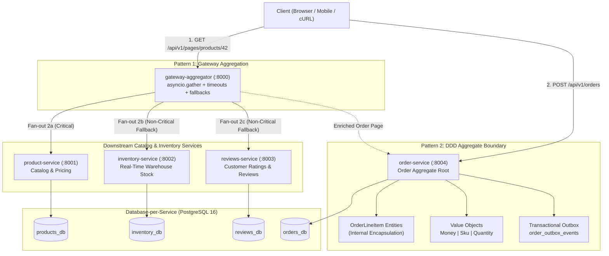

<p align="center">
  
  
  
  
  
</p>

# 🏛️ FastAPI Microservices: Gateway Aggregation vs. DDD Aggregate

> **A didactic microservices laboratory contrasting the two paradigms that share the name "Aggregate": the distributed network composition pattern (Gateway Aggregator) and the Domain-Driven Design consistency boundary (DDD Aggregate Root).**  
> *Orchestrated with Docker Compose, PostgreSQL 16 (Database-per-Service), RFC 7807 Problem Details, Optimistic Concurrency Control, and Transactional Outbox.*

---

## 📌 Executive Summary & Architectural Clarification

In distributed software engineering, the word **"Aggregate"** represents two fundamentally distinct architectural concepts that are often conflated:

```
┌────────────────────────────────────────────────────────────────────────────────────────┐
│                              THE TWO AGGREGATE PARADIGMS                               │
├───────────────────────────────────────────┬────────────────────────────────────────────┤
│ 1. Gateway Aggregator Pattern             │ 2. DDD Aggregate Pattern                   │
│    (Distributed Network & Composition)    │    (Domain Modeling & Consistency Boundary)│
├───────────────────────────────────────────┼────────────────────────────────────────────┤
│ • Solves: Chatty network I/O, frontend    │ • Solves: Inconsistent object state across │
│   fan-out, device-tailored payloads.      │   complex associations within a transaction.│
│ • Boundary: Network / RPC boundary.       │ • Boundary: ACID transaction boundary.    │
│ • Core Mechanism: Concurrent I/O          │ • Core Mechanism: Encapsulation through an │
│   (asyncio.gather / Scatter-Gather)       │   Aggregate Root enforcing invariants.     │
│ • Key Law: "Latency ≈ slowest call,       │ • Key Law: "References from outside the   │
│   not the sum of all calls."              │   aggregate should go only to the root."   │
│ • Trade-off: Requires timeouts, fallbacks │ • Trade-off: Concurrency contention, needs │
│   and graceful partial degradation.       │   optimistic locking and domain events.    │
└───────────────────────────────────────────┴────────────────────────────────────────────┘
```

This laboratory implements **both patterns** inside a unified, production-structured e-commerce and fintech microservices ecosystem, allowing you to run, test, benchmark, and contrast them side-by-side.

---

## 🏗️ Architecture & System Topology



---

## 🧩 Deep Dive: The Two Patterns

### 1. Gateway Aggregator Pattern (`services/gateway_aggregator/`)

When a mobile or web client renders a product page, calling `product-service`, `inventory-service`, and `reviews-service` separately over cellular network causes high latency ($T_{\text{total}} = T_{\text{product}} + T_{\text{inventory}} + T_{\text{reviews}}$) and battery drain.

The **Gateway Aggregator** receives a single client request and executes an asynchronous scatter-gather fan-out:

```python
# Concurrently scatter requests across downstream microservices
(
    (prod_res, prod_ms, prod_err),
    (inv_res, inv_ms, inv_err),
    (rev_res, rev_ms, rev_err),
) = await asyncio.gather(fetch_product(), fetch_inventory(), fetch_reviews())
```

#### ⚡ Latency Benchmark: Parallel vs. Sequential
- **Sequential Mode**: $T \approx 80\text{ms} + 150\text{ms} + 100\text{ms} = \mathbf{330\text{ms}}$
- **Parallel Mode**: $T \approx \max(80\text{ms}, 150\text{ms}, 100\text{ms}) \approx \mathbf{150\text{ms}}$ (**>50% latency reduction**)

#### 🛡️ Resiliency & Graceful Partial Degradation
- **Critical Service (`product-service`)**: If product is missing (404) or unavailable (5xx/timeout), the aggregator fails fast and responds with RFC 7807 Problem Details (`504 Gateway Timeout` or `503 Service Unavailable`).
- **Non-Critical Services (`reviews-service`, `inventory-service`)**: If reviews or inventory timeout or throw 500, the aggregator applies default fallback models, marks `composition_status = "degraded"`, and returns the product page without failing the user experience.

---

### 2. DDD Order Aggregate (`services/order_service/`)

An **Aggregate** in Domain-Driven Design is a cluster of domain objects treated as a single transactional consistency unit:
1. **Aggregate Root (`Order`)**: The only gateway for mutating the aggregate. External services never reference internal entities (`OrderLineItem`) directly; they reference the `Order` root by ID.
2. **Encapsulated Invariants**:
   - **Monetary Precision**: Exact `Decimal` two-decimal quantization via `Money` Value Object.
   - **Order Total Cap**: Order aggregate total cannot exceed `$50,000.00`.
   - **Per-SKU Quantity Limit**: Maximum `10` units per line item.
   - **State Machine Guard**: Confirmed or cancelled orders become strictly immutable.
   - **Encapsulated Collection**: `order.items` returns an immutable `tuple[OrderLineItem, ...]`, preventing callers from bypassing root validation via list `.append()` or `.pop()`.
3. **Optimistic Concurrency Control**: Uses integer `version` field. Updates enforce `WHERE id = :id AND version = :loaded_version`. Concurrent modifications trigger an immediate `409 Conflict`.
4. **Transactional Outbox**: Emits domain events (`OrderCreated`, `OrderItemAdded`, `OrderConfirmed`) committed atomically into `order_outbox_events` in the exact same database transaction.

---

## 📁 Repository Directory Structure

```
fastapi-microservices-aggregate/
├── 📄 pyproject.toml              # Modern Python 3.11+ dependencies & tools configuration
├── 🐳 Dockerfile                  # Production container definition (uv-powered)
├── 🐳 docker-compose.yml          # 6 containers (Postgres 16 + 5 FastAPI microservices)
├── 🛠️ Makefile                    # Developer automation targets
├── 📖 README.md                   # Technical documentation (English)
├── 📖 GUIDE_PT_BR.md              # Didactic architecture study guide (pt-BR)
│
├── 📂 infra/
│   └── 📂 postgres/
│       └── 📄 init-databases.sql  # Database-per-service initialization
│
├── 📂 shared/                     # Shared kernel (zero duplicate boilerplate)
│   ├── 📄 db.py                   # Async SQLAlchemy engine & session factory
│   ├── 📄 errors.py               # RFC 7807 Problem Details middleware
│   ├── 📄 health.py               # Standardized /health and /ready endpoints
│   ├── 📄 logging.py              # Structured JSON logging
│   ├── 📄 pagination.py           # Standardized REST pagination envelope
│   └── 📄 simulation.py           # Network delay & fault injection helper
│
├── 📂 services/
│   ├── 📂 gateway_aggregator/     # Pattern 1: Gateway Aggregation Service (:8000)
│   │   ├── 📄 aggregator.py       # Parallel scatter-gather, timeouts & fallbacks
│   │   ├── 📄 clients.py          # Long-lived HTTP connection registry
│   │   ├── 📄 config.py           # Downstream URLs & timeouts
│   │   ├── 📄 main.py             # FastAPI entrypoint
│   │   └── 📄 schemas.py          # Unified composition schemas
│   │
│   ├── 📂 product_service/        # Product Catalog Service (:8001)
│   ├── 📂 inventory_service/      # Warehouse Inventory Service (:8002)
│   ├── 📂 reviews_service/        # Customer Reviews Service (:8003)
│   │
│   └── 📂 order_service/          # Pattern 2: DDD Order Aggregate Service (:8004)
│       ├── 📂 domain/             # Pure Domain Core (Zero external framework dependencies)
│       │   ├── 📄 value_objects.py   # Money, Sku, Quantity, OrderId
│       │   ├── 📄 order_aggregate.py # Aggregate Root & LineItem Entity
│       │   ├── 📄 events.py          # Immutable domain events
│       │   └── 📄 exceptions.py      # Invariant violations & state errors
│       ├── 📂 infrastructure/     # Database models & optimistic locking repository
│       ├── 📂 application/        # Application service & command DTOs
│       └── 📂 api/                # REST API endpoints & RFC 7807 error translation
│
├── 📂 scripts/
│   └── 📄 demo_showcase.py        # Interactive CLI walkthrough script
│
└── 📂 tests/                      # Automated test suite (27 passing tests)
    ├── 📄 conftest.py             # In-memory async SQLite fixtures & ASGI transports
    ├── 📂 unit/
    │   └── 📄 test_order_aggregate.py
    ├── 📂 integration/
    │   ├── 📄 test_gateway_aggregator.py
    │   └── 📄 test_order_service_api.py
    └── 📂 contract/
        └── 📄 test_openapi_contracts.py
```

---

## 📡 API Reference & Quick Verification

### 1. Gateway Aggregator (`:8000`)

#### Compare Parallel vs. Sequential Latency
```bash
# Parallel mode (default) — Latency ≈ slowest call
curl -s "http://localhost:8000/api/v1/pages/products/42?mode=parallel&product_delay_ms=80&inventory_delay_ms=150&reviews_delay_ms=100" | python3 -m json.tool

# Sequential mode — Latency = sum of all calls
curl -s "http://localhost:8000/api/v1/pages/products/42?mode=sequential&product_delay_ms=80&inventory_delay_ms=150&reviews_delay_ms=100" | python3 -m json.tool
```

#### Test Graceful Fallback
```bash
# Reviews service fails -> Aggregator returns product + fallback reviews (HTTP 200)
curl -s "http://localhost:8000/api/v1/pages/products/42?fail_reviews=true" | python3 -m json.tool
```

#### Test Critical Service Timeout
```bash
# Product delay (200ms) exceeds timeout (50ms) -> RFC 7807 HTTP 504 Gateway Timeout
curl -s "http://localhost:8000/api/v1/pages/products/42?timeout_ms=50&product_delay_ms=200" | python3 -m json.tool
```

---

### 2. DDD Order Service (`:8004`)

#### Create Order Aggregate Root
```bash
curl -i -X POST "http://localhost:8004/api/v1/orders" \
  -H "Content-Type: application/json" \
  -d '{"customer_id": "cust-vip-100", "currency": "USD"}'
```

#### Add Line Item through Aggregate Root
```bash
curl -s -X POST "http://localhost:8004/api/v1/orders/<ORDER_ID>/items" \
  -H "Content-Type: application/json" \
  -d '{
    "product_id": 42,
    "sku": "TECH-LAPTOP-42",
    "product_name": "UltraPro Developer Laptop",
    "unit_price": 2499.00,
    "quantity": 2
  }' | python3 -m json.tool
```

#### Invariant Violation Test: Quantity > 10
```bash
curl -s -X POST "http://localhost:8004/api/v1/orders/<ORDER_ID>/items" \
  -H "Content-Type: application/json" \
  -d '{
    "product_id": 43,
    "sku": "ACC-KEYBOARD-43",
    "product_name": "Mechanical Keyboard",
    "unit_price": 189.50,
    "quantity": 15
  }' | python3 -m json.tool
```
*Expected Response (`application/problem+json`):*
```json
{
  "type": "https://api.example.com/errors/domain-invariant-violation",
  "title": "Domain Invariant Violation",
  "status": 422,
  "detail": "Maximum allowed quantity per order line item is 10 units.",
  "instance": "/api/v1/orders/<ORDER_ID>/items"
}
```

#### Confirm Order & Inspect Outbox Events
```bash
# Confirm order
curl -s -X POST "http://localhost:8004/api/v1/orders/<ORDER_ID>/confirm" | python3 -m json.tool

# Inspect Transactional Outbox domain events
curl -s "http://localhost:8004/api/v1/orders/<ORDER_ID>/events" | python3 -m json.tool
```

---

## 🚀 How to Run

### Option A: Complete Docker Compose Stack (Recommended)
Prerequisites: [Docker Desktop](https://docs.docker.com/get-docker/) running.

```bash
cd fastapi-microservices-aggregate

# Start all 6 containers in the background
make up
# Or: docker compose up --build -d

# Check service status and healthchecks
make ps

# Run interactive didactic showcase
make demo

# Tear down containers
make down
```

### Option B: Local Testing & Development
Prerequisites: Python 3.11+.

```bash
cd fastapi-microservices-aggregate

# Create virtualenv and install dependencies
python3 -m venv .venv
.venv/bin/pip install -e ".[dev]"

# Run full test suite (27 tests: unit, integration, OpenAPI contracts)
make test
# Or: .venv/bin/pytest -v

# Run code style & linting checks
make lint
make format
```

---

## 📚 Study Guides & Further Reading

- 🇧🇷 **[Guia Didático Aprofundado (pt-BR)](./GUIDE_PT_BR.md)**: Análise arquitetural completa sobre por que os dois padrões usam a palavra *Aggregate*, leis de latência, tolerância a falhas, invariantes de negócio e controle de concorrência otimista.
- 📐 **[RFC 7807 Problem Details](https://datatracker.ietf.org/doc/html/rfc7807)**: Padrão de respostas de erro para APIs REST.
- 📖 **Domain-Driven Design (Eric Evans, Martin Fowler)**: Conceito de Aggregate Root como fronteira de consistência.
